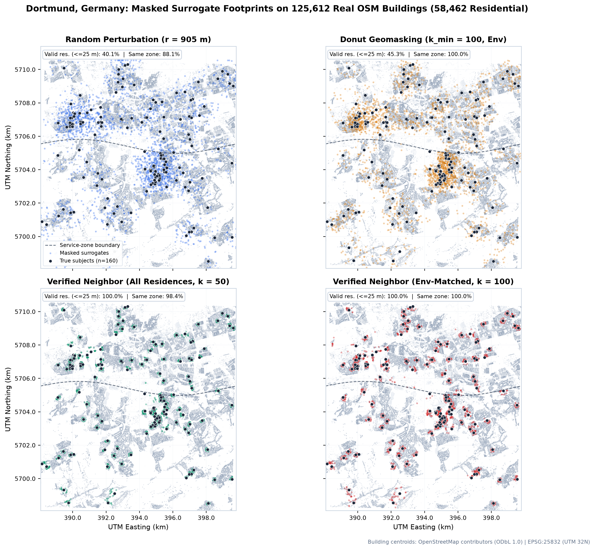

# Anonymization of Georeferenced Microdata (Verified Neighbor Geomasking)

Python implementation and real-world OpenStreetMap benchmark of **Verified Neighbor geomasking** (Richter, 2018) compared against **Random Perturbation** and **Donut Geomasking** (Hampton et al., 2010), evaluated in exact metric UTM coordinates across **Dortmund, Germany (`EPSG:25832`)** with cross-region validation on **Erie County, NY (`EPSG:26918`)**.

M.Sc. Data Science seminar study (*Anonymization of Georeferenced Microdata*, Prof. Dr. Rainer Lenz, TU Dortmund University, Winter Term 2023/24) pairing a critical technical evaluation of Wayne Richter's *JESEE* (2018) framework with a reproducible Python geospatial benchmark (`scipy.spatial.cKDTree`, Ripley/Besag $L(r) - r$, Kulldorff discrete Poisson spatial scan, Hotelling's $T^2$, and Rayleigh circular tests) running directly on `179,006` real OpenStreetMap building centroids.


---

## Why Naive Geographic Masking Breaks on Real Cities

Releasing individual-level georeferenced records (disease registries, mobility logs, socioeconomic surveys, or environmental exposure tables) forces a hard trade-off between **geoprivacy** and **spatial utility**:

- **Spatial aggregation** (collapsing coordinates to postcodes or administrative districts) prevents address reverse-geocoding but erases local distances, exposure boundaries, and sub-kilometer hotspot structure.
- **Fixed-radius Random Perturbation** uses one circle everywhere regardless of urban morphology. On compact Dortmund (`EPSG:25832`), Richter's Erie County radius ($r = 905\ \text{m}$) massively over-masks central neighborhoods (up to $k = 2{,}570$ residences, smearing local clusters and scattering ~60% of masked points off residential buildings onto garages, commercial corridors, parks, or Phoenix-See) while still dipping to $k = 57$ on sparse outskirts. Tightening the radius to $r = 500\ \text{m}$ drops worst-case privacy down to $k = 10$ at the rural fringe.
- **Donut Geomasking** scales its ring using coarse block-group residential density, assuming uniform density inside every tile. Across heterogeneous city-to-fringe transitions it overshoots target $k$ up to `42x` in Dortmund (`k = 4,227`) and `60x` in Erie County (`k = 6,078`), distorting spatial clusters.

**Verified Neighbor geomasking** eliminates worst-case reverse-geocoding gaps directly: index verified residential building centroids with a `cKDTree`, optionally filter to residences sharing the subject's environmental service zone, drop addresses inside a $50\ \text{m}$ safety exclusion buffer, and sample uniformly from the exact $k$ closest qualifying residences.

---

## Real OpenStreetMap Datasets & Projection Pipeline

All coordinates come from public OpenStreetMap building footprints fetched via Overpass (`src/fetch_osm_data.py`), projected from WGS84 (`EPSG:4326`) into exact metric UTM zones using 4th-order transverse Mercator series in pure NumPy (zero external GIS binary dependencies):

| Study Region | CRS (UTM) | Extent | OSM Buildings | Residential | Non-Residential | OSM Tagging Rule |
| :--- | :--- | :---: | :---: | :---: | :---: | :--- |
| **Dortmund, Germany** *(Primary)* | `EPSG:25832` (32N) | 11.71 x 12.46 km | **125,612** | **58,462** | 67,150 | Explicit residential tags + addressed `building=yes` (excludes garages, allotment houses, industrial, commercial, campus) |
| **Erie County, NY** *(Validation)* | `EPSG:26918` (18N) | 15.25 x 13.78 km | **53,394** | **50,252** | 3,142 | Excludes explicit commercial, industrial, civic, and garage tags (accounts for NYS GIS `building=yes` import schema) |

### Experimental Design (`src/landscape.py`, `src/metrics.py`)

- **Zero personal data:** Each region draws `160` real residential OSM centroids (`100` uniform random background residences matching Kulldorff's Poisson null, plus `35` primary-cluster and `25` secondary-cluster residences in two real neighborhoods; `seed = 42`).
- **Environmental service zones:** Each region is partitioned into a North/South corridor zone plus a low-density `Rural_Fringe_Zone` based on local `500 m` residential density.
- **50 Monte Carlo replicates x 10 configurations** per region (**80,000 masked realizations** per city, `160,000` total):
  1. **Worst-case spatial $k$-anonymity:** Exact realized residential pool size and share of subjects achieving target $k$, plus residential placement plausibility (`<= 25 m` from an actual residential OSM centroid).
  2. **Displacement & directional bias:** Mean/median/max displacement, net mean-center shift across 50 replicates tested via **Hotelling's $T^2$** ($p < 0.05$), and directional pull via the **Rayleigh circular test** ($p < 0.05$).
  3. **Point-pattern preservation:** Besag's centered $L(r) - r = \sqrt{K(r)/\pi} - r$ RMSE across $r \in [150, 3000]\ \text{m}$ and sub-kilometer scales ($r \le 1000\ \text{m}$).
  4. **Hotspot cluster recovery:** Purely spatial **Kulldorff discrete Poisson scan statistic** (same likelihood-ratio formulation used by SaTScan):

$$\text{LLR}(Z) = c_Z \log\!\left(\frac{c_Z}{\mu_Z}\right) + (C - c_Z) \log\!\left(\frac{C - c_Z}{C - \mu_Z}\right) \cdot \mathbb{I}(c_Z > \mu_Z)$$

evaluated over circular block-group windows up to 25% of residential buildings across all 50 replicates.

---

## Primary Results: Dortmund, Germany (`EPSG:25832`)

Full exported table: [`results/dortmund_benchmark_summary.csv`](results/dortmund_benchmark_summary.csv) (`12 x 12` metric UTM grid; ground-truth primary cluster in Hoerde / Phoenix-See South spans `3` tiles, `LLR = 33.94`).

| Method | Target $k$ | Achieve $k$ (%) | Min / Max $k$ | Valid Res. (%) | Same Env (%) | Mean / Med Disp (m) | Sub-1 km $L(r)$ RMSE | Cluster In / Out (of 3) | Cluster Jaccard |
| :--- | :---: | :---: | :---: | :---: | :---: | :---: | :---: | :---: | :---: |
| Random Perturbation ($r = 500\ \text{m}$) | 100 | 98.8% | 10 / 1,101 | 46.6% | 96.3% | 336.2 / 355.9 | 130.1 m | 2.52 / 4.44 | 0.385 |
| Random Perturbation ($r = 905\ \text{m}$) | 100 | 99.4% | 57 / 2,570 | 40.1% | 88.1% | 600.7 / 637.0 | 274.3 m | 2.36 / 4.92 | 0.339 |
| Donut Geomasking ($k_{\min} = 100$, Env) | 100 | 99.4% | 95 / 4,227 | 45.3% | 100.0% | 558.3 / 509.6 | 174.9 m | 2.28 / 4.52 | 0.355 |
| **Verified Neighbor (All, $k = 50$)** | 50 | **100.0%** | 50 / 50 | **100.0%** | 98.4% | **105.9 / 95.2** | **13.8 m** | 2.54 / 1.62 | 0.645 |
| **Verified Neighbor (All, $k = 100$)** | 100 | **100.0%** | 100 / 100 | **100.0%** | 98.3% | **143.7 / 129.9** | **27.1 m** | 2.48 / 1.76 | 0.627 |
| Verified Neighbor (All, $k = 200$) | 200 | 100.0% | 200 / 200 | 100.0% | 97.7% | 201.7 / 186.1 | 35.8 m | 2.52 / 1.80 | 0.643 |
| **Verified Neighbor (Env, $k = 50$)** | 50 | **100.0%** | 50 / 50 | **100.0%** | **100.0%** | **109.7 / 95.0** | **12.4 m** | **2.70 / 1.06** | **0.768** |
| **Verified Neighbor (Env, $k = 100$)** | 100 | **100.0%** | 100 / 100 | **100.0%** | **100.0%** | **154.5 / 129.9** | **21.7 m** | **2.76 / 0.88** | **0.808** |
| Verified Neighbor (Env, $k = 200$) | 200 | 100.0% | 200 / 200 | 100.0% | 100.0% | 224.0 / 188.3 | 32.4 m | 2.68 / 1.64 | 0.704 |

### Key Takeaways From Real Dortmund Data

1. **Exact privacy without urban over-masking:** Verified Neighbor held `100.0%` of subjects to exact target $k$ and placed `100.0%` of surrogates on verified residential OSM buildings. Fixed-radius RP (`905 m`) put `59.9%` of surrogates off residential buildings while over-masking inner Dortmund up to $k = 2{,}570$; tightening RP to `500 m` dropped outskirt privacy to $k = 10$.
2. **4x to 5.6x smaller displacement & up to 20x sharper local fidelity:** At $k = 50$ to $100$, Verified Neighbor lowered mean displacement to `105.9-154.5 m` (vs. `600.7 m` RP `905 m` and `558.3 m` Donut) and reduced sub-1 km Besag $L(r) - r$ RMSE from `274.3 m` (RP) and `174.9 m` (Donut) down to `12.4-27.1 m`.
3. **2.3x cleaner hotspot recovery:** On Kulldorff's Poisson spatial scan, Verified Neighbor (Env, $k = 100$) reached `Jaccard = 0.808` (`2.76 / 3` true tiles with `0.88` false-positive tiles outside), compared to `0.339` (`4.92` outside) for RP `905 m` and `0.355` (`4.52` outside) for Donut Geomasking.
4. **Authentic real-street directional bias:** Because real Dortmund street networks end abruptly at parks, rail corridors, industrial belts, and the Ruhr valley, local neighbor pools are asymmetric (`Hotelling T^2`: `61.9%-71.9%`, `Rayleigh`: `65.6%-72.5%`), directly matching Richter's empirical Erie County findings (`Hotelling T^2`: `43%-74%`, `Rayleigh`: `43%-69%`). Strict environmental zone matching preserves `100%` zone fidelity at the cost of longer rural jumps (up to `4.4 km` at $k = 100$).

---

## Visual Diagnostics (Dortmund, Germany)

### Spatial Footprint Across 125,612 Real OSM Buildings

Notice how Random Perturbation and Donut Geomasking scatter `55%-60%` of surrogates onto non-residential land (Phoenix-See, Westfalenpark, industrial strips, TU Dortmund campus, garages), whereas Verified Neighbor stays strictly on real residential footprints and respects the east-west corridor boundary under environmental matching.



### Realized $k$-Anonymity & Net Displacement CDF


### Spatial Pattern Fidelity ($L(r) - r$) & Kulldorff Spatial Scan


---

## Cross-Region Validation: Erie County, NY (`EPSG:26918`)

To verify that these findings transfer from a compact European city (Dortmund) to a sprawling US county matching Richter's (2018) original study area, the exact same pipeline was executed on `53,394` real OSM building centroids across Buffalo, Cheektowaga, Amherst, and Lancaster (`14 x 13` metric UTM grid; ground-truth primary cluster spans `9` tiles, `LLR = 62.58`).

Full results and all four diagnostic figures are kept in [`results/erie_county/benchmark_summary.csv`](results/erie_county/benchmark_summary.csv) and [`figures/erie_county/`](figures/erie_county/). Selected highlights:

| Method (Erie County, NY) | Achieve $k$ (%) | Min / Max $k$ | Valid Res. (%) | Mean Disp (m) | Sub-1 km $L(r)$ RMSE | Cluster In / Out (of 9) | Cluster Jaccard |
| :--- | :---: | :---: | :---: | :---: | :---: | :---: | :---: |
| Random Perturbation ($r = 500\ \text{m}$) | 78.8% | 14 / 1,771 | 46.6% | 336.4 m | 200.0 m | 6.98 / 1.22 | 0.710 |
| Random Perturbation ($r = 905\ \text{m}$) | 93.1% | 40 / 4,164 | 36.5% | 603.3 m | 409.3 m | 7.00 / 2.20 | 0.646 |
| Donut Geomasking ($k_{\min} = 100$, Env) | 100.0% | 122 / 6,078 | 43.3% | 777.2 m | 372.6 m | 5.10 / 10.22 | 0.246 |
| **Verified Neighbor (All, $k = 50$)** | **100.0%** | 50 / 50 | **100.0%** | **149.3 m** | **33.9 m** | **8.26 / 0.06** | **0.916** |
| **Verified Neighbor (Env, $k = 100$)** | **100.0%** | 100 / 100 | **100.0%** | **238.2 m** | **23.5 m** | 6.16 / 2.32 | 0.557 |

On Erie County's wider urban-to-rural gradient, fixed-radius RP (`905 m`) left `11 / 160` subjects below $k = 100$ (`34 / 160` at `500 m`) and Donut Geomasking smeared the 9-tile hotspot across `10.22` false-positive tiles outside (`Jaccard = 0.246`), while Verified Neighbor (`All, k = 50`) achieved `0.916` cluster Jaccard (`0.06` outside spillover) and cut sub-kilometer $L(r) - r$ RMSE by more than `12x`.

---

## Repository Structure

```text
.
├── data/
│   ├── dortmund_osm_buildings.csv.gz     # 125,612 real OSM buildings (EPSG:25832)
│   ├── erie_county_osm_buildings.csv.gz  # 53,394 real OSM buildings (EPSG:26918)
│   └── ATTRIBUTION.md                    # OpenStreetMap ODbL 1.0 credit and tagging notes
├── src/
│   ├── fetch_osm_data.py                 # Overpass API fetcher + pure-NumPy WGS84-to-UTM projector
│   ├── landscape.py                      # Real OSM landscape loader, UTM block grid, and service zones
│   ├── geomasking.py                     # Verified Neighbor (cKDTree), Random Perturbation, Donut Geomasking
│   ├── metrics.py                        # Hotelling T^2, Rayleigh circular test, Besag L(r)-r, Kulldorff scan
│   └── run_benchmark.py                  # Deterministic 50-replicate benchmark and plot generator (both regions)
├── tests/
│   └── test_geomasking.py                # Unit tests verifying k-anonymity, exclusion buffer, env match, LLR
├── results/
│   ├── dortmund_benchmark_summary.csv    # Primary Dortmund benchmark results
│   └── erie_county/
│       └── benchmark_summary.csv         # Full Erie County cross-validation results
├── figures/
│   ├── verified_neighbor_pipeline.png    # Primary Dortmund figures
│   ├── spatial_methods_comparison.png
│   ├── privacy_vs_displacement.png
│   ├── ripley_and_cluster_utility.png
│   └── erie_county/                      # Full Erie County diagnostic figures
└── requirements.txt                      # Minimal scientific stack (numpy, scipy, pandas, matplotlib)
```

## Quick Start

```bash
git clone https://github.com/r-a-j/georeferenced-microdata-anonymization.git
cd georeferenced-microdata-anonymization
python -m venv .venv
source .venv/bin/activate   # On Windows: .venv\Scripts\activate
pip install -r requirements.txt

# Run unit tests across both Dortmund and Erie County OSM datasets
python -m unittest discover -s tests -v

# Reproduce full 50-replicate benchmarks, CSV exports, and all 8 figures
python -m src.run_benchmark

# Optional: refresh OSM building centroid extracts directly from Overpass API
python -m src.fetch_osm_data
```

---

## Data Attribution & References

- **Map Data:** Building centroids derived from OpenStreetMap via the Overpass API. Map data (c) OpenStreetMap contributors, available under the [Open Database License (ODbL 1.0)](https://www.openstreetmap.org/copyright). No personal or medical data are included.
- **Richter, W. (2018).** *The verified neighbor approach to geoprivacy: An improved method for geographic masking.* Journal of Exposure Science & Environmental Epidemiology, 28(2), 109-118. https://doi.org/10.1038/jes.2017.17
- **Hampton, K. H., Fitch, M. K., Allshouse, W. B., et al. (2010).** *Mapping health data: Improved privacy protection with donut method geomasking.* American Journal of Epidemiology, 172(9), 1062-1069.
- **Kulldorff, M. (1997).** *A spatial scan statistic.* Communications in Statistics - Theory and Methods, 26(6), 1481-1496.
- **Seminar:** *Anonymization of Georeferenced Microdata*, Prof. Dr. Rainer Lenz, TU Dortmund University (Winter Term 2023/24).
