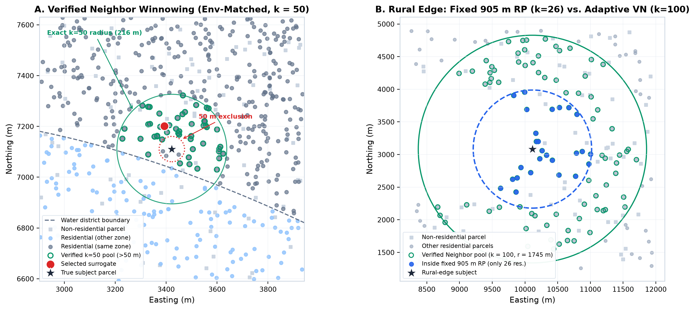
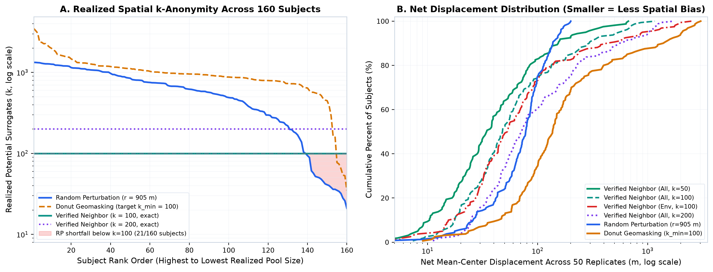
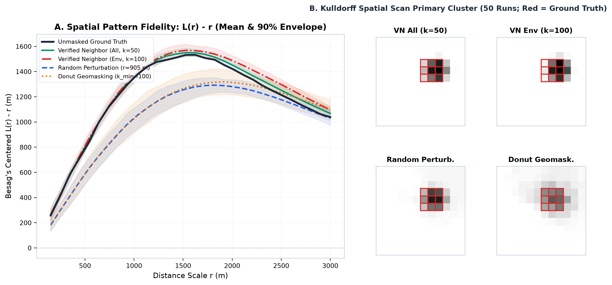

# Anonymization of Georeferenced Microdata (Verified Neighbor Geomasking)

Python implementation and spatial-privacy benchmark of **Verified Neighbor geomasking** (Richter, 2018) compared against **Random Perturbation** and **Donut Geomasking** (Hampton et al., 2010).

Originated as my M.Sc. Data Science seminar study (*Anonymization of Georeferenced Microdata*, Prof. Dr. Rainer Lenz, TU Dortmund University, Winter Term 2023/24) analyzing Wayne Richter's *Journal of Exposure Science & Environmental Epidemiology* (2018) paper, extended here with a standalone, reproducible Python codebase (`scipy.spatial.cKDTree`, Ripley's $L(r) - r$, Kulldorff discrete Poisson spatial scan, Hotelling's $T^2$, and Rayleigh circular tests) to empirically reproduce the privacy-utility trade-offs.



---

## Why Geographic Masking Fails Naive Methods

Sharing individual-level georeferenced records (health outcomes, mobility traces, socioeconomic surveys, or environmental exposure data) creates a direct conflict between **geoprivacy** and **spatial analytical utility**:

- **Spatial aggregation** (collapsing points to zip codes or administrative polygons) hides individual addresses but destroys sub-regional distance metrics, environmental exposure linkage, and local hotspot detection.
- **Fixed-radius random perturbation** displaces every point within the same circle regardless of local housing density. In sparse rural outskirts, too few real residences fall inside the circle, leaving subjects vulnerable to reverse geocoding ($k$-anonymity failure). In dense urban cores, points are displaced much farther than necessary and frequently land in non-residential space (commercial strips, parks, or lakes).
- **Donut geomasking** scales the displacement ring using coarse census-block population density, which assumes uniform density inside each polygon. In heterogeneous regions it frequently overshoots target $k$, displaces points kilometers away, and smears spatial disease clusters.

**Verified Neighbor geomasking** solves worst-case disclosure risk directly by indexing verified residential parcel centroids with a spatial tree (`cKDTree`), optionally filtering to parcels sharing the subject's environmental zone (such as public water district), excluding centroids inside a safety buffer (e.g., $50\ \text{m}$), and sampling uniformly from the exact $k$ closest valid residences.

---

## Benchmark Design (`src/run_benchmark.py`)

To evaluate all three methods reproducibly without proprietary parcel records, `src/landscape.py` generates a $12\ \text{km} \times 12\ \text{km}$ projected study area (`seed = 42`):

- **12,000 property parcel centroids** (`9,666` residential, `2,334` non-residential across commercial corridors, urban core, town center, suburban belt, sparse rural outskirts, and an uninhabited lake void).
- **144 census block groups** ($1\ \text{km} \times 1\ \text{km}$ grid) and **3 environmental exposure zones** (`Water_District_A`, `Water_District_B`, and rural `Private_Well`).
- **160 study subjects** mirroring Richter's (2018) Erie County design: `100` background residences plus `35` primary-hotspot and `25` secondary-hotspot subjects.
- **50 Monte Carlo masking replicates** per method across 9 configurations (**72,000 masked realizations** total).

### Quantitative Metrics Implemented (`src/metrics.py`)

1. **Worst-case spatial $k$-anonymity:** Exact count of valid residential parcels inside each subject's masking footprint and share of subjects achieving target $k$.
2. **Displacement & directional bias:** Individual mean/median/max displacement, net mean-center shift across 50 replicates tested via **Hotelling's $T^2$** ($p < 0.05$), and directional bias via the **Rayleigh circular test** ($p < 0.05$).
3. **Spatial point-pattern preservation:** Besag's centered $L(r) - r = \sqrt{K(r)/\pi} - r$ RMSE across distance scales $r \in [150, 3000]\ \text{m}$ and sub-kilometer scales ($r \le 1000\ \text{m}$).
4. **Hotspot cluster recovery:** Purely spatial **Kulldorff discrete Poisson scan statistic** (same likelihood-ratio formulation used by SaTScan):

$$\text{LLR}(Z) = c_Z \log\!\left(\frac{c_Z}{\mu_Z}\right) + (C - c_Z) \log\!\left(\frac{C - c_Z}{C - \mu_Z}\right) \cdot \mathbb{I}(c_Z > \mu_Z)$$

evaluated over circular block-group scanning windows up to 25% of residential parcels across all 50 replicates.

---

## Empirical Results (`results/benchmark_summary.csv`)

| Method | Target $k$ | Achieve $k$ (%) | Min / Max $k$ | Valid Res. (%) | Same Env (%) | Mean / Med Disp (m) | $L(r)-r$ RMSE (m) | Sub-1km RMSE (m) | Cluster In / Out (of 9) |
| :--- | :---: | :---: | :---: | :---: | :---: | :---: | :---: | :---: | :---: |
| Random Perturbation ($r = 905\ \text{m}$) | 100 | 86.9% | 21 / 1,332 | 52.4% | 91.8% | 602.8 / 639.6 | 204.1 | 230.7 | 5.86 / 3.20 |
| Donut Geomasking ($k_{\min} = 100$, Env) | 100 | 96.2% | 35 / 3,486 | 52.1% | 100.0% | 1125.6 / 860.9 | 199.1 | 230.2 | 5.16 / 7.42 |
| **Verified Neighbor (All, $k = 50$)** | 50 | **100.0%** | 50 / 50 | **100.0%** | 94.4% | **250.2 / 178.3** | **25.9** | **11.3** | **5.86 / 1.30** |
| **Verified Neighbor (All, $k = 100$)** | 100 | **100.0%** | 100 / 100 | **100.0%** | 94.1% | **350.2 / 249.3** | **50.4** | **22.0** | 4.56 / 1.80 |
| Verified Neighbor (All, $k = 200$) | 200 | 100.0% | 200 / 200 | 100.0% | 93.0% | 489.1 / 347.2 | 101.1 | 44.7 | 4.70 / 2.22 |
| **Verified Neighbor (Env, $k = 50$)** | 50 | **100.0%** | 50 / 50 | **100.0%** | **100.0%** | **300.4 / 179.2** | **33.6** | **11.6** | **5.40 / 1.36** |
| **Verified Neighbor (Env, $k = 100$)** | 100 | **100.0%** | 100 / 100 | **100.0%** | **100.0%** | **446.0 / 249.2** | **52.1** | **15.9** | **5.22 / 2.02** |
| Verified Neighbor (Env, $k = 200$) | 200 | 100.0% | 200 / 200 | 100.0% | 100.0% | 661.7 / 353.5 | 94.8 | 46.2 | 4.86 / 2.46 |

### Key Takeaways (Consistent With Richter, 2018)

1. **Worst-case privacy guarantee:** Random perturbation left `21 / 160` subjects below $k = 100$ (dropping as low as $k = 21$ in rural outskirts) while over-masking urban subjects up to $k = 1{,}332$. Verified Neighbor guaranteed exact $k$ for `100%` of subjects and placed `100%` of surrogates on genuine residential parcels (zero coordinates in lakes or commercial strips).
2. **Order-of-magnitude sharper spatial fidelity:** At $k = 50$ to $100$, Verified Neighbor cut mean displacement by `42%` to `59%` relative to Random Perturbation (`602.8 m`) and by `60%` to `78%` relative to Donut Geomasking (`1,125.6 m`), reducing sub-kilometer Besag $L(r) - r$ RMSE from `~230 m` down to `11.3–22.0 m`.
3. **Cleaner hotspot detection:** Under Kulldorff's Poisson spatial scan across 50 runs, Donut Geomasking averaged `7.42` false-positive block groups outside the primary cluster (`Jaccard = 0.368`) and Random Perturbation averaged `3.20`, while Verified Neighbor kept outside spillover down to `1.30–2.02` block groups.
4. **Intrinsic 3-way trade-off:** Enforcing strict environmental zone matching (`100%` water-district fidelity) increases search distances for sparse fringe parcels (mean displacement rises from `350.2 m` to `446.0 m` at $k = 100$; max reaches `7,014 m` for isolated rural private wells). Directional shift (Rayleigh `32%–51%`) also increases at density edges because residential neighbors cluster toward populated sides, mirroring Richter's Erie County Hotelling $T^2$ (`43%–74%`) and Rayleigh (`43%–69%`) findings.

---

## Visual Diagnostics

### Spatial Footprint Across Density Regimes

Notice how Random Perturbation and Donut Geomasking scatter points across non-residential space and the uninhabited lake void, while Verified Neighbor keeps every surrogate on real residential parcels and respects the water-district boundary when environmental matching is enabled.


### Realized $k$-Anonymity & Net Displacement CDF



### Spatial Pattern Preservation ($L(r) - r$) & Kulldorff Cluster Scan



---

## Repository Structure

```text
.
├── src/
│   ├── landscape.py          # 12 km x 12 km heterogeneous parcel, block-group, and water-zone generator
│   ├── geomasking.py         # Verified Neighbor (cKDTree), Random Perturbation, and Donut Geomasking
│   ├── metrics.py            # Hotelling T^2, Rayleigh circular test, Besag L(r)-r, Kulldorff Poisson scan
│   └── run_benchmark.py      # Deterministic 50-replicate benchmark and figure generation
├── tests/
│   └── test_geomasking.py    # Unit tests verifying k-anonymity, exclusion radius, env match, and scan LLR
├── results/
│   └── benchmark_summary.csv # Full exported quantitative benchmark table
├── figures/                  # Publication-grade diagnostic plots generated by run_benchmark.py
└── requirements.txt          # Minimal pure scientific stack (numpy, scipy, pandas, matplotlib)
```

## Quick Start

```bash
git clone https://github.com/r-a-j/georeferenced-microdata-anonymization.git
cd georeferenced-microdata-anonymization
python -m venv .venv
source .venv/bin/activate   # On Windows: .venv\Scripts\activate
pip install -r requirements.txt

# Run invariant tests
python -m unittest discover -s tests -v

# Reproduce full 50-replicate benchmark, CSV results, and figures
python -m src.run_benchmark
```

---

## References

- **Richter, W. (2018).** *The verified neighbor approach to geoprivacy: An improved method for geographic masking.* Journal of Exposure Science & Environmental Epidemiology, 28(2), 109-118. https://doi.org/10.1038/jes.2017.17
- **Hampton, K. H., Fitch, M. K., Allshouse, W. B., et al. (2010).** *Mapping health data: Improved privacy protection with donut method geomasking.* American Journal of Epidemiology, 172(9), 1062-1069.
- **Kulldorff, M. (1997).** *A spatial scan statistic.* Communications in Statistics - Theory and Methods, 26(6), 1481-1496.
- **Seminar:** *Anonymization of Georeferenced Microdata*, Prof. Dr. Rainer Lenz, TU Dortmund University (Winter Term 2023/24).
